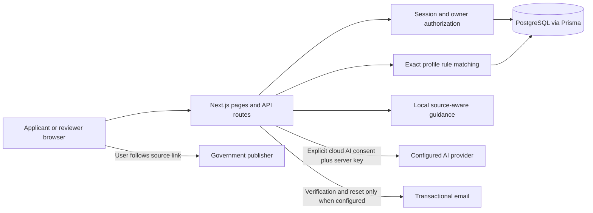

# Architecture

The repository contains one Next.js App Router application. React screens and route handlers share TypeScript models and Zod validation. Prisma connects to PostgreSQL; there is no in-memory persistence substitute. Tailwind provides styling, and Lucide provides icons. Application routes render the account's saved state through JSON APIs.

## Records and ownership

`User` stores account fields, a password hash, reviewer role, and independent AI/notification consent. `Session` stores a hashed opaque cookie token and expiry; raw tokens are never returned in account exports. `AuthToken` supports one-time verification and reset links. Applicant accounts cannot grant themselves an administrative role through an API request.

Every `Application` belongs to one `User`. Its `ChecklistItem`, `Task`, `Message`, `ProfileVersion`, and `InterviewAnswer` records derive authorization from that owner. A user cannot authorize a request merely by knowing a UUID. Handlers query owned resources and return the same 404 for an unknown ID or another applicant's ID; denial events enter the audit log.

`Source` records registered government publishers and source snapshots. `Rule` records exact destination/nationality/residence/jurisdiction/visa type, excerpt, version, review state, expiry, and reviewer. `ChecklistItem` binds one case to one applicable rule and stores self-reported status, notes, and a not-applicable reason. `AuditLog` records security and administrative events; `RateLimit` provides database-backed limits shared by app instances.

## Scope changes

A case's initial profile becomes version 1. Editing a changed field increments the version and retains the old profile snapshot. A serializable database transaction updates the profile and synchronizes its checklist. Only matching reviewed rules participate; an obsolete checklist item's status is removed instead of being carried into a different jurisdiction. Repeating an unchanged profile edit does not fabricate a new version.

The current rule set uses the latest reviewed version for each requirement. A draft does not replace a reviewed rule. A later rejection or expiry prevents an older approved version from silently returning. Read operations synchronize applicable checklist items so stale approvals disappear from the active case.

## Three verification states

| State | Meaning | Applicant behavior |
| --- | --- | --- |
| `VERIFIED` | At least one matching, approved, non-demo, unexpired rule has a cited official source. | Show reviewed individual rules and the completeness warning; still check current government instructions. |
| `DEMO` | The exact sample scope has demonstration records only. | Show sample preparation tasks, clearly labeled educational and unverified. |
| `UNKNOWN` | No active reviewed records match the exact profile. | Show the unknown-scope notice and government source links; do not borrow another profile's checklist. |

`VERIFIED` describes the individual stored rules, not the entire application, completeness of the checklist, document authenticity, eligibility, or an approval prediction.

## Assistant boundaries

The server prepares context from the owned case and applicable rule citations. Local mode is always available. A live provider additionally needs reviewed `VERIFIED` rules, server configuration, an available daily budget, and the applicant's cloud AI consent. Demo and unknown scopes stay local. Provider context includes the five profile scope fields, reviewed rule text, self-reported status codes, and the submitted question; it excludes the applicant's name/email, notes, reasons, and conversation history. Provider keys remain server-side. Assistant output is guidance; it does not change checklist statuses, create tasks, submit a visa application, fetch arbitrary URLs, send messages, or charge a payment. Applicants explicitly save tasks through the UI.

Interview practice is text only. It stores the question, answer, and preparation feedback; it does not score visa approval likelihood or fabricate supporting facts.

## Runtime

PostgreSQL is the only required external runtime service. Prisma migrations define the schema and seeding installs registered source links plus demo rules. Optional email and AI calls use configured providers. The optional Redis Compose service is reserved for future background work. There is no worker, object store, document pipeline, payment webhook, or microphone integration in this release.
